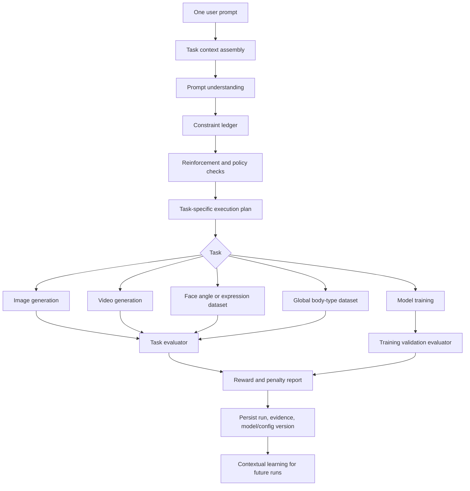

# Unified Prompt Reinforcement and Creative Pipeline

**Branch:** `feature/unified-prompt-reinforcement-training`  
**Status:** Incremental implementation. Reward/penalty learning and automatic optimization are explicitly ON HOLD pending validated evaluation evidence.

## Goals

1. Give the user one natural-language prompt field per creative task. Do not expose separate positive, negative, or model-final prompt fields in the normal UI.
2. Preserve the original request and explicit constraints. Prompt reinforcement may clarify ambiguity and improve task-specific structure, but must not silently change identity, requested body proportions, pose, expression, scene, style, or other explicit attributes.
3. Use the existing global **Training method** setting as the single source of truth: LoRA or full fine-tuning.
4. Use the existing global **Compute device** setting as the single source of truth: automatic, CPU, local CUDA, or configured remote GPU. Display detected hardware names.
5. Reuse the existing face profile IDs, per-profile datasets, face-angle groups, expression groups, shared global body-type dataset/model, generation library, job progress, and feedback persistence.
6. Record transparent reward and penalty evidence for images, videos, face-angle/expression/body dataset outputs, and training validation. Learn cautiously from prior outcomes without treating unverified heuristics as ground truth.

## Target data flow

### 1. Input and context

- The visible input is one prompt box for each task.
- The task context is supplied by existing controls, not retyped: selected profile ID, task, selected face angle, selected expression, global body-type toggle/group, output settings, reference image presence, selected global training method, selected global compute backend, model family, and available resource limits.
- A missing or contradictory required selection is surfaced before expensive work starts.
- Preserve the exact original prompt for audit and replay.

### 2. Prompt understanding and reinforcement

- Use the existing `PromptEngine` as the structured prompt-understanding entry point.
- Return an internal structured result: original prompt, clarified positive conditioning, internal negative constraints, extracted intent/constraints, task parameters, rationale, provider/model version, and uncertainty.
- The user sees one prompt field and a concise optional explanation/preview summary; internal conditioning is not a second required user input.
- When the configured prompt provider is unavailable, use the existing transparent deterministic fallback. Never claim semantic understanding or silently invent details.
- Keep a constraint ledger with hard constraints (must preserve) and soft preferences (may optimize). Hard constraints always outrank aesthetic optimization and learned preferences.
- Aesthetic quality, human alignment, bias mitigation, and diversity are separate objectives with explicit weights and evidence. Diversity must not randomly alter a specified person, identity, protected trait, or user-requested scene.
- Do not infer sensitive traits. Do not infer or alter identity from a face image beyond the explicitly selected face-profile workflow.

### 3. Automatic generation controls

- Remove the user-facing reference-strength slider from ordinary image generation.
- Derive image-to-image strength server-side from task type, reference presence, explicit change magnitude, profile/identity preservation requirements, and validated model limits.
- Use conservative defaults for identity-preserving edits; use stronger change only when the request explicitly asks for a major transformation.
- Keep per-task parameters validated and bounded. The UI must not imply that a setting is dynamically optimized unless the selection logic and evidence are implemented.
- Keep seed, model version, prompt-engine version, settings, and backend recorded for reproducibility.

### 4. Task-specific execution and evaluation

| Task | Context and constraints | Evaluation evidence |
|---|---|---|
| Image | Profile/LoRA, reference, composition, style, aspect ratio | Prompt adherence, technical validity, composition, image quality; identity/anatomy require validated evaluators or human review |
| Video | Profile, motion intent, frame count, duration, temporal constraints | Frame validity, flicker/temporal consistency, prompt adherence; identity consistency needs validated evaluation or human review |
| Face angles | Existing profile ID, exact target angle/yaw/pitch, source identity | Pose estimate, face visibility, identity consistency; uncertain pose or identity requires review |
| Expressions | Existing profile ID, requested expression target | Expression evidence, pose stability, identity consistency; uncertain results require review |
| Global body type | Shared global dataset, body-shape prompt, no face-profile reassignment | Target adherence, anatomy/pose technical checks, diversity across samples; human review for ambiguous anatomy |
| LoRA training | Selected profile, dataset manifest, global method=LoRA, selected backend | Dataset checks, training completion, loss/validation signals where available, load test, held-out sample review |
| Full fine-tuning | Explicit global method=full_finetune, compatible base model, sufficient compute/data | Dedicated trainer validation, checkpoints, held-out evaluation, rollback/load test |

Each evaluator must declare its metric source and confidence. Technical checks are not a substitute for semantic or human judgments.

### 5. Reward and penalty design — ON HOLD

**No implementation in the current milestone.** Existing feedback and contextual-bandit code must remain unchanged. Do not feed unvalidated scores into generation settings, prompt selection, training, or backend routing. Resume only after task-specific evaluators have evidence, confidence, and regression tests. Until then, outputs may be stored and reviewed using existing behavior, but no automatic reward-driven adaptation is permitted.

- Reuse `prompt_intelligence/evaluation.py`, `feedback_service.py`, `feedback_store.py`, and the contextual `PreferenceBandit` where appropriate.
- Normalize rewards to [-1, 1], but store individual dimensions and evidence rather than only a scalar.
- Positive evidence may include explicit prompt adherence, successful target pose, valid anatomy checks, temporal stability, successful model load, and user preference ratings.
- Penalties may include failed technical validation, target mismatch, unintended identity drift, missing/cropped requested content, temporal flicker, failed model load, resource failure, and explicit user rejection.
- Every penalty must identify its evidence source, severity, and confidence. Do not apply a severe identity penalty based only on an unvalidated face-similarity heuristic.
- Do not award a high reward solely because generation completed. Completion and quality are separate.
- Avoid double-counting correlated metrics. Unknown metrics remain unknown; do not fill missing scores with invented positives.
- Keep human feedback distinct from automated estimates. Provide a correction/override path and record who/what supplied each score.
- Partition learning by task, model family/version, backend class, and relevant control context. Never transfer image preferences blindly to video or training.
- Use minimum sample counts, bounded updates, drift checks, and a rollback/version mechanism before learned preferences affect production defaults.

### 6. Global training-method dispatcher

- The global setting is authoritative; per-form hidden defaults must not override it.
- `lora`: use the current LoRA trainer and its current validation/limits.
- `full_finetune`: dispatch only to a dedicated full-finetuning implementation after compatibility, memory, dataset, checkpoint, and rollback checks.
- Until a real full-finetuning trainer passes tests, keep it visibly unavailable/guarded with a clear explanation. Never silently fall back to LoRA when full fine-tuning is selected.
- The same method selection applies to face profiles and the shared global body model only where the trainer explicitly supports that target.
- Preserve the selected profile ID and dataset ownership throughout training and result persistence.

### 7. Global compute-device dispatcher

- Keep the global compute setting authoritative for all tasks.
- Resolve actual hardware at runtime and show its detected name, VRAM, and availability.
- Auto mode selects only a healthy, compatible backend. Explicit backend selection must fail clearly if unavailable; do not silently route to a different machine.
- Keep remote authentication, request timeouts, cancellation, progress, and worker health checks.
- Avoid repeatedly probing a remote worker inside generation loops. Cache short-lived health results and probe at job start or explicit refresh.

## TODO — implementation sequence

### Phase A — contracts and regression protection
- [ ] Document and test one canonical task request schema shared by UI and API.
- [ ] Add tests for constraint precedence, prompt preservation, prompt-provider fallback/error, and structured output validation.
- [ ] Add tests that global training method and compute backend are read once per job and recorded in its immutable run context.
- [ ] Add migration-safe fields for prompt plan, original prompt, internal conditioning, rationale, metric evidence, reward/penalty details, model versions, and evaluator versions.
- [ ] Add tests proving old profiles, LoRA files, datasets, generated assets, and existing feedback remain readable.

### Phase B — single-input UX (ACTIVE)

- [ ] Replace visible positive/negative/final-prompt controls with one prompt input on image and video pages.
- [ ] Apply the same one-prompt contract to face-angle, expression, and global body-type dataset generation.
- [ ] Keep face profile, angle, expression, body-type scope, and global dropdowns as structured task context.
- [ ] Remove the reference-strength slider from the normal image UI.
- [ ] Show a compact "prompt plan" explanation and allow the user to inspect the original request; do not require prompt editing in a second box.
- [ ] Keep accessibility labels, validation, progress, cancellation, and error messages.

### Phase C — prompt reinforcement engine (ACTIVE, deterministic safeguards first)

- [ ] Extend the existing PromptEngine with schema-versioned task plans and a constraint ledger.
- [ ] Implement task-specific prompt policies for image, video, face angles, expressions, and global body-type generation.
- [ ] Add explicit aesthetic, human-alignment, bias-mitigation, and diversity objectives with configurable bounded weights.
- [ ] Add a deterministic, transparent fallback when no semantic provider is configured.
- [ ] Add adversarial tests for prompt injection in provider output, constraint deletion, invented identity details, and invalid task parameters.

### Phase D — automatic parameter policy (ACTIVE)

- [ ] Implement task-specific strength selection for reference-image generation and validate supported ranges.
- [ ] Keep strength internal and record selected value plus rationale.
- [ ] Add regression tests for identity-preserving edits, large requested transformations, no-reference text-to-image, and unsupported combinations.

### Phase E — task evaluators and feedback (ON HOLD)
- [ ] Keep all reward-driven configuration changes disabled until validated evidence exists.
- [ ] Do not change current feedback/bandit behavior during Phases B–D.

- [ ] Define separate image, video, face-angle, expression, body-type, and training evaluators.
- [ ] Separate technical checks, semantic/model estimates, and human scores in persisted evidence.
- [ ] Add explainable reward and penalty reports with confidence, metric source, and missing-data handling.
- [ ] Add per-task contextual learning with sample thresholds, bounded updates, and rollback.
- [ ] Add a user feedback control for accept/reject and optional dimension ratings after outputs.
- [ ] Ensure generation success does not imply quality success.

### Phase F — training and backend integration
- [ ] Implement a single global training-method dispatcher.
- [ ] Keep LoRA behavior unchanged initially and add regression tests for existing trained profiles.
- [ ] Design and implement full fine-tuning as a separate trainer only after base-model compatibility, data requirements, GPU memory planning, checkpointing, validation, and rollback are defined.
- [ ] Apply the same global compute dispatcher to image, video, dataset generation, and training.
- [ ] Add per-job backend/model/method snapshots so changing global settings does not mutate already-running jobs.
- [ ] Verify local and GHive workers with authenticated health checks, progress, cancellation, and clear unavailable-backend behavior.

### Phase G — release and verification
- [ ] Run unit tests, API tests, frontend checks, migration tests, and end-to-end smoke tests.
- [ ] Verify old profile IDs and both existing LoRA files load without retraining.
- [ ] Verify all dataset groups remain visible, including empty groups, and body-type data remains global.
- [ ] Verify reward history can be traced to the exact output, task, profile, model, backend, and evaluator version.
- [ ] Roll out behind feature flags and preserve a rollback path.

## NOT TODO — explicit exclusions and guardrails

- Do not retrain, rename, merge, delete, or recreate existing face profiles or LoRA weights as part of this refactor.
- Do not change profile IDs, dataset group IDs, ownership, or the shared global body-type profile.
- Do not remove the global Training method or Compute device dropdowns.
- Do not silently substitute LoRA for full fine-tuning, CPU for an unavailable explicitly selected GPU, or GHive for a different backend.
- Do not expose separate positive, negative, or final-prompt textareas as required user inputs. Internal conditioning may still have positive and negative components.
- Do not let an LLM overwrite explicit user constraints or add unrequested people, identity traits, body features, or scene content.
- Do not claim that a generated image/video is aesthetically excellent, identity-preserving, unbiased, or diverse without suitable evidence.
- Do not treat automated face/pose/anatomy heuristics as definitive ground truth.
- Do not optimize diversity by changing the identity or explicit characteristics of a selected real person.
- Do not train directly on unreviewed failed/mismatched generated samples by default.
- Do not use raw generation completion, elapsed time, or resource consumption as a quality reward.
- Do not add expensive always-on GPU probes, uncontrolled retries, recursive generation loops, or repeated provider calls per denoising step.
- Do not download new base models or change CUDA/PyTorch dependencies as part of the UI/prompt refactor.
- Do not change the main branch. All work stays on `feature/unified-prompt-reinforcement-training`.

## Current implementation reality and gaps

- The repository already has a `PromptEngine` that accepts one prompt internally and can return structured positive/negative conditioning. It currently depends on a configured OpenAI-compatible endpoint for semantic understanding; its fallback preserves text and adds only a generic negative prompt.
- The repository already has a feedback evaluator, PostgreSQL feedback persistence, and a contextual bandit. The current evaluator has limited image/pose dimensions and deliberately requests human review for unknown dimensions.
- The repository already has a prompt-feedback foundation, but this is not yet a complete multi-task reinforcement-learning system. The contextual bandit learns preferences among validated configurations; it does not train diffusion weights or guarantee improved outputs.
- The existing face trainer is LoRA. The application intentionally blocks full fine-tuning until a dedicated trainer exists.
- The current generation forms still expose multiple prompt fields and a user-facing reference-strength control. The task-specific dataset workflows have their own structured target prompts/strength values.
- Existing generated-image/video and dataset workflows must be migrated incrementally; changing only the image form would leave inconsistent task behavior.

## Acceptance criteria

1. Each creative task exposes one user-authored prompt field; task controls remain structured context.
2. Original prompt and hard constraints are preserved and auditable.
3. Internal prompt conditioning is validated and never presented as an additional required user input.
4. Reference strength is selected server-side with a recorded rationale and bounded by task/model compatibility.
5. Rewards and penalties are traceable to evidence, evaluator version, and task context; missing evidence stays unknown.
6. Image, video, angle, expression, body-type, and training outcomes use separate evaluators.
7. Global training method and compute-device selections govern every applicable job consistently.
8. Existing face profiles, LoRA models, datasets, and historical assets remain intact.
9. Full fine-tuning is not advertised as available until a real, tested trainer is installed.
10. Tests and a staged rollback path pass before the feature is enabled by default.

## Current milestone hold point

- Active now: migrate image/video to one prompt input; remove visible positive/negative/final prompt fields; remove the user-controlled image reference-strength slider; derive bounded strength server-side; retain global settings and task controls.
- Still pending: migrate face-angle/expression/body-type dataset forms to the same single-prompt contract, add stronger constraint-ledger validation and provider-backed prompt understanding, and test all paths.
- On hold: reward/penalty evaluator expansion, reward-driven automatic improvement, contextual-bandit updates, and any reinforcement learning from previous outputs.
- Full fine-tuning remains unavailable until its dedicated trainer exists. Do not silently dispatch to LoRA.
